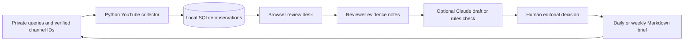

# Secret Sauce intelligence workbench

Local pilot, November 23, 2026. Python 3.9+ on macOS/Linux; standard library only. No LangChain, package installation, cloud account or model key is needed for demo mode. This is a single-user desk, not a team deployment.

## Start in five minutes

From this repository's root, run:

```bash
python3 -m intelligence init
python3 -m intelligence demo
python3 -m intelligence serve --port 8765
```

Open **http://127.0.0.1:8765** on the same computer. Stop the server with Ctrl-C. Restarting preserves saved records. `localhost` is deliberately not accepted: use the exact address printed above.

1. Keep **Demo · synthetic** selected. Six synthetic candidates demonstrate the workflow without implying real market findings.
2. Select a candidate and add an evidence note. For this walkthrough, explicitly write that it is a synthetic test. Enter inspection coverage and access basis.
3. Allow analysis only for notes you may send to a model provider. With models off, **Run evidence check** performs a deterministic readiness check, not AI interpretation.
4. Record a decision. Leave scores blank when unsupported. TEST and DEVELOP_PILOT require a primary behavioral cohort but remain recommendations; they never dispatch production.
5. Open **Editorial briefs** and build the daily brief. Download Markdown. Daily briefs include at most five reviewed candidates; weekly shortlists include at most three eligible opportunities.
6. Switch to **Live · YouTube**. It starts empty. Synthetic records cannot enter this workspace.

Brief membership and the decision version are frozen when created, even if empty. Review first, then build. Subsequent source metadata refreshes are reflected; expired/deleted evidence disappears. Previously included candidates are not recycled into later briefs of the same kind. This is a reviewed shortlist, not an automated breakout ranking.

## What runs where



| Layer | Implementation | Responsibility |
| --- | --- | --- |
| Collection / A1 subset | `youtube.py`, fixed read-only API endpoints | Discover candidates, deduplicate, refresh source counters, record failures |
| Evidence review / A2 subset | `agents.py`, `prompts/reviewer.txt` | Validate note references and optional model drafts; never infer verified demographics |
| Editorial planning / A8 subset | `store.py` and the review desk | Save a person's recommendations and assemble bounded briefs |
| Persistence | SQLite, schema in `store.py` | Observations, notes, analyses, decision versions, briefs, runs, budget counters, daily slots |
| Interface | `server.py`, plain HTML/CSS/JavaScript | Local inbox, evidence/decision forms, source snapshots, run history, connections |
| Scheduling | Explicit foreground `worker` command | At most one collection attempt per UTC day; no installed background service |

These are bounded workflow functions, not eight deployed autonomous agents. No agent framework is needed to operate this first version. A durable job service, authentication and PostgreSQL are later deployment work.

## Connect YouTube

Owner: engineer with access to the organization's Google Cloud project; research lead owns source/query selection.

1. Enable YouTube Data API v3 in your Google Cloud project and obtain an appropriately restricted API key using the [official getting-started instructions](https://developers.google.com/youtube/v3/getting-started). Check available quota in that project.
2. Provide `YOUTUBE_API_KEY` through your local environment or secret manager. Do not paste it in chat, the review desk, a tracked config file or shell history. The application does not load `.env` automatically.
3. Edit **`.runtime/intelligence/config.json`**, created by `init`: set `live_collection_enabled` to `true`; review query lists and the request caps. The example config in this directory is public and contains no credentials.
4. Run `python3 -m intelligence doctor` to check configuration presence without printing secrets.
5. Run `python3 -m intelligence collect` once. Inspect **Run history** and verify returned sources manually before using findings.
6. Restart the web server from the environment containing the key. Switch the desk to Live.

F02 discovers scripted-series candidates; F04 gaming candidates; F07 queries verified authority channel IDs for Roblox-relevant uploads. Search is a bounded recent-results sample, not a census. Default: 14-day lookback, 10 results/query, 30 search attempts and 60 total request attempts per UTC day, up to 100 items requested for refresh per run. These are application caps, **not Google quota-unit calculations**. New discoveries get priority; older records outside the refresh cap eventually expire. Missing counters remain unavailable, never zero-filled.

The ten-person panel is not verified automatically. Add up to ten entries to private `authority_channels` with `channel_id` (exact UC identifier), `name`, `verification_note`, ISO `verified_at`, and `cadence` (`daily` or `three_times_weekly`, Monday/Wednesday/Friday UTC). Use the existing panel document as a list of candidates to verify. With no configured panel, collection reports PARTIAL and explicitly identifies F07 as skipped. F04 excludes verified panel channels to keep amplification separate from grassroots discovery.

Series grouping, episode order and audiovisual inspection remain manual. No video, audio, transcript, comment text, profile or viewer data is downloaded by this collector.

## Optional Claude drafts

Owner: engineer configures access and spend controls; research lead approves eligible notes; editor reviews every draft.

Set `ANTHROPIC_API_KEY` privately, then set `model.enabled=true` and an exact available `model.name` in the private config. The adapter uses the [Claude Messages API](https://platform.claude.com/docs/en/api/messages/create), with configurable API version (example: `2026-10-21`). Restart the server after changing environment variables. No paid call is made automatically by collection or briefing.

Only notes explicitly marked analysis-permitted are submitted: ID, text, evidence type, coverage and access basis. Source API metadata, counters and other local files are excluded. Reviewers must not circumvent this separation by copying restricted API data or identifiable youth data into notes. The default allowance is five calls/day, at most 1,200 output tokens/call and a 24 KB notes packet. **These are request/input/output caps, not a dollar spending cap.** Configure the provider account's spending controls separately.

The model must return JSON with summary, optional cohort hypothesis, at most four hypotheses, limitations and a WATCH/INVESTIGATE/RIGHTS_REVIEW recommendation. Each hypothesis cites an existing note and an exact excerpt. Invalid citations, invalid JSON and incomplete responses are rejected; failed attempts still consume the call allowance. No automatic paid retries. Exact quotation checks establish traceability, not factual truth or causal support. No model output is automatically human-approved or used to authorize production.

## Daily operation and roles

| Step | Owner | Action / exit condition |
| --- | --- | --- |
| Source setup | Research lead + engineer | Verified channel identities, approved access, bounded queries, private credentials |
| Collection | Collector | Record COMPLETED, PARTIAL or FAILED; inspect any gaps before interpreting coverage |
| Evidence review | Research analyst | Actually inspect the material; record observation versus interpretation and coverage |
| Optional draft | Reviewer + Claude adapter | Submit only permitted notes; reject unsupported conclusions |
| Editorial decision | Producer / showrunner | Assign route and relevant cohort; separate viral, story/IP and execution assessments |
| Brief | Editor | Build after review; five daily findings / three weekly opportunities maximum |
| Learning | Research lead | Compare reviewer corrections and usefulness; adjust queries and source coverage |

To run collection continuously in a foreground terminal:

```bash
python3 -m intelligence worker
```

It checks every 60 seconds, attempts collection once per UTC day, and persists the daily slot across restarts. A failed scheduled attempt is not automatically retried that day. Inspect its error before manually running `collect`; persistent budgets still apply. `worker --once` makes one scheduled attempt and exits. Overlapping workers are blocked by a process lock. After a crash, the next lock-owning collector marks unfinished runs INTERRUPTED. The worker does not generate model drafts, make decisions, create briefs, send messages or publish anything. It only runs while the process and computer are active; no cron, launch agent or hosted scheduler has been installed.

## Storage and source constraints

Private runtime defaults to `.runtime/intelligence`, ignored by Git. Select another location using `BUMPP_DATA_DIR` or `python3 -m intelligence --data-dir /absolute/private/path COMMAND`. Database/config files are local, not encrypted by the app. Directory permissions restrict local access, but there is no login or identity verification; reviewer names are self-entered.

Live observations and related annotations older than 29 days are deleted during access, collection or `python3 -m intelligence purge`. If the application is not running, deletion cannot run: arrange a reliable cleanup service before ongoing live operation, or delete the dataset when shutting it down for an extended period. Unavailable videos are removed when their IDs are refreshed. Deletion cascades through notes, decisions, analyses and brief membership. Exports, OS backups and provider retention are outside this cleanup; manage those separately. No local delete changes YouTube itself.

**Implementation departure from the earlier design:** standard YouTube API data is not used to calculate growth, velocity, composite ratings or automatic trend scores. Editorial ratings must rely on independently usable evidence and are prominently distinguished from YouTube counters. Earlier desired metric-ranking fields in design documents are conditional future capabilities, not enabled features. This conservative choice follows the [YouTube developer policies](https://developers.google.com/youtube/terms/developer-policies), especially III.E.4 and the special permissions in section L; it is not a claim that this prototype has passed a platform audit.

## Validation and next release

```bash
python3 -m unittest discover -s intelligence/tests -v
node --check intelligence/static/app.js
```

The unit/integration suite covers dataset separation, budgets, deduplication, missing values, expiration/deletion, locks, failed scheduling, evidence citations, model input isolation, version-bound briefs and local HTTP protections. Network services are mocked; passing tests does not establish successful live credentials, coverage or model quality. Browser QA uses synthetic records only.

Next: one real collector run with configured access; analyst review of its coverage; a small rubric-based evaluation of model drafts; then authenticated shared hosting, durable scheduling and additional feeds. Video generation, Roblox production, first-party performance ingestion and automatic experiment execution are not implemented. See [implementation status](../docs/production-engine/IMPLEMENTATION_STATUS.md).
