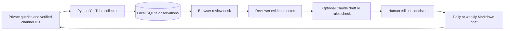

# Admin source library update — November 23, 2026

The browser admin now opens **Sources** in the real research workspace. Demo fixtures remain available only through the CLI for software testing; they are not shown as research.

Use **Sources → Add source** to save a name, HTTPS link, type, feed and research notes. Nine previously supplied creative references are preloaded once; duplicates are rejected. The Sources page separately displays all ten feed definitions (nine external plus one internal), ten authority-panel candidates, discovery queries, Reddit community candidates and supporting research surfaces from the existing specification. These definitions do not imply connected collectors or verified accounts. Use **Edit source** to update or archive a reference. Saved references persist privately in SQLite and are independent of collected candidates. Saving does not verify a source or start monitoring. The existing collector still uses private query/panel configuration; automatic collection from the new source library is a subsequent integration step.

The ten-feed list under Connections describes implementation coverage, not the source-entry form. API keys still belong in private configuration, never source notes.

The earlier demo walkthrough below documents the CLI test fixture workflow; the browser dataset selector no longer exposes demo mode.

# Secret Sauce intelligence workbench

Local pilot, November 23, 2026. Python 3.9+ on macOS/Linux; standard library only. No LangChain, package installation, cloud account or model key is needed for demo mode. This is a single-user desk, not a team deployment.

## Start in five minutes

From this repository's root, run:

```bash
python3 -m intelligence init
python3 -m intelligence demo
python3 -m intelligence serve --port 8765
```

Open **http://127.0.0.1:8765** on the same computer. Stop the server with Ctrl-C. Restarting preserves saved records. `localhost` is deliberately not accepted: use the exact address printed above.

1. Keep **Demo · synthetic** selected. Six synthetic candidates demonstrate the workflow without implying real market findings.
2. Select a candidate and add an evidence note. For this walkthrough, explicitly write that it is a synthetic test. Enter inspection coverage and access basis.
3. Allow analysis only for notes you may send to a model provider. With models off, **Run evidence check** performs a deterministic readiness check, not AI interpretation.
4. Record a decision. Leave scores blank when unsupported. TEST and DEVELOP_PILOT require a primary behavioral cohort but remain recommendations; they never dispatch production.
5. Open **Editorial briefs** and build the daily brief. Download Markdown. Daily briefs include at most five reviewed candidates; weekly shortlists include at most three eligible opportunities.
6. Switch to **Live · YouTube**. It starts empty. Synthetic records cannot enter this workspace.

Brief membership and the decision version are frozen when created, even if empty. Review first, then build. Subsequent source metadata refreshes are reflected; expired/deleted evidence disappears. Previously included candidates are not recycled into later briefs of the same kind. This is a reviewed shortlist, not an automated breakout ranking.

## What runs where



| Layer | Implementation | Responsibility |
| --- | --- | --- |
| Collection / A1 subset | `youtube.py`, fixed read-only API endpoints | Discover candidates, deduplicate, refresh source counters, record failures |
| Evidence review / A2 subset | `agents.py`, `prompts/reviewer.txt` | Validate note references and optional model drafts; never infer verified demographics |
| Editorial planning / A8 subset | `store.py` and the review desk | Save a person's recommendations and assemble bounded briefs |
| Persistence | SQLite, schema in `store.py` | Observations, notes, analyses, decision versions, briefs, runs, budget counters, daily slots |
| Interface | `server.py`, plain HTML/CSS/JavaScript | Local inbox, evidence/decision forms, source snapshots, run history, connections |
| Scheduling | Explicit foreground `worker` command | At most one collection attempt per UTC day; no installed background service |

These are bounded workflow functions, not eight deployed autonomous agents. No agent framework is needed to operate this first version. A durable job service, authentication and PostgreSQL are later deployment work.

## Connect YouTube

Owner: engineer with access to the organization's Google Cloud project; research lead owns source/query selection.

1. Enable YouTube Data API v3 in your Google Cloud project and obtain an appropriately restricted API key using the [official getting-started instructions](https://developers.google.com/youtube/v3/getting-started). Check available quota in that project.
2. Provide `YOUTUBE_API_KEY` through your local environment or secret manager. Do not paste it in chat, the review desk, a tracked config file or shell history. The application does not load `.env` automatically.
3. Edit **`.runtime/intelligence/config.json`**, created by `init`: set `live_collection_enabled` to `true`; review query lists and the request caps. The example config in this directory is public and contains no credentials.
4. Run `python3 -m intelligence doctor` to check configuration presence without printing secrets.
5. Run `python3 -m intelligence collect` once. Inspect **Run history** and verify returned sources manually before using findings.
6. Restart the web server from the environment containing the key. Switch the desk to Live.

F02 discovers scripted-series candidates; F04 gaming candidates; F07 queries verified authority channel IDs for Roblox-relevant uploads. Search is a bounded recent-results sample, not a census. Default: 14-day lookback, 10 results/query, 30 search attempts and 60 total request attempts per UTC day, up to 100 items requested for refresh per run. These are application caps, **not Google quota-unit calculations**. New discoveries get priority; older records outside the refresh cap eventually expire. Missing counters remain unavailable, never zero-filled.

The ten-person panel is not verified automatically. Add up to ten entries to private `authority_channels` with `channel_id` (exact UC identifier), `name`, `verification_note`, ISO `verified_at`, and `cadence` (`daily` or `three_times_weekly`, Monday/Wednesday/Friday UTC). Use the existing panel document as a list of candidates to verify. With no configured panel, collection reports PARTIAL and explicitly identifies F07 as skipped. F04 excludes verified panel channels to keep amplification separate from grassroots discovery.

Series grouping, episode order and audiovisual inspection remain manual. No video, audio, transcript, comment text, profile or viewer data is downloaded by this collector.

## Optional Claude drafts

Owner: engineer configures access and spend controls; research lead approves eligible notes; editor reviews every draft.

Set `ANTHROPIC_API_KEY` privately, then set `model.enabled=true` and an exact available `model.name` in the private config. The adapter uses the [Claude Messages API](https://platform.claude.com/docs/en/api/messages/create), with configurable API version (example: `2026-10-21`). Restart the server after changing environment variables. No paid call is made automatically by collection or briefing.

Only notes explicitly marked analysis-permitted are submitted: ID, text, evidence type, coverage and access basis. Source API metadata, counters and other local files are excluded. Reviewers must not circumvent this separation by copying restricted API data or identifiable youth data into notes. The default allowance is five calls/day, at most 1,200 output tokens/call and a 24 KB notes packet. **These are request/input/output caps, not a dollar spending cap.** Configure the provider account's spending controls separately.

The model must return JSON with summary, optional cohort hypothesis, at most four hypotheses, limitations and a WATCH/INVESTIGATE/RIGHTS_REVIEW recommendation. Each hypothesis cites an existing note and an exact excerpt. Invalid citations, invalid JSON and incomplete responses are rejected; failed attempts still consume the call allowance. No automatic paid retries. Exact quotation checks establish traceability, not factual truth or causal support. No model output is automatically human-approved or used to authorize production.

## Daily operation and roles

| Step | Owner | Action / exit condition |
| --- | --- | --- |
| Source setup | Research lead + engineer | Verified channel identities, approved access, bounded queries, private credentials |
| Collection | Collector | Record COMPLETED, PARTIAL or FAILED; inspect any gaps before interpreting coverage |
| Evidence review | Research analyst | Actually inspect the material; record observation versus interpretation and coverage |
| Optional draft | Reviewer + Claude adapter | Submit only permitted notes; reject unsupported conclusions |
| Editorial decision | Producer / showrunner | Assign route and relevant cohort; separate viral, story/IP and execution assessments |
| Brief | Editor | Build after review; five daily findings / three weekly opportunities maximum |
| Learning | Research lead | Compare reviewer corrections and usefulness; adjust queries and source coverage |

To run collection continuously in a foreground terminal:

```bash
python3 -m intelligence worker
```

It checks every 60 seconds, attempts collection once per UTC day, and persists the daily slot across restarts. A failed scheduled attempt is not automatically retried that day. Inspect its error before manually running `collect`; persistent budgets still apply. `worker --once` makes one scheduled attempt and exits. Overlapping workers are blocked by a process lock. After a crash, the next lock-owning collector marks unfinished runs INTERRUPTED. The worker does not generate model drafts, make decisions, create briefs, send messages or publish anything. It only runs while the process and computer are active; no cron, launch agent or hosted scheduler has been installed.

## Storage and source constraints

Private runtime defaults to `.runtime/intelligence`, ignored by Git. Select another location using `BUMPP_DATA_DIR` or `python3 -m intelligence --data-dir /absolute/private/path COMMAND`. Database/config files are local, not encrypted by the app. Directory permissions restrict local access, but there is no login or identity verification; reviewer names are self-entered.

Live observations and related annotations older than 29 days are deleted during access, collection or `python3 -m intelligence purge`. If the application is not running, deletion cannot run: arrange a reliable cleanup service before ongoing live operation, or delete the dataset when shutting it down for an extended period. Unavailable videos are removed when their IDs are refreshed. Deletion cascades through notes, decisions, analyses and brief membership. Exports, OS backups and provider retention are outside this cleanup; manage those separately. No local delete changes YouTube itself.

**Implementation departure from the earlier design:** standard YouTube API data is not used to calculate growth, velocity, composite ratings or automatic trend scores. Editorial ratings must rely on independently usable evidence and are prominently distinguished from YouTube counters. Earlier desired metric-ranking fields in design documents are conditional future capabilities, not enabled features. This conservative choice follows the [YouTube developer policies](https://developers.google.com/youtube/terms/developer-policies), especially III.E.4 and the special permissions in section L; it is not a claim that this prototype has passed a platform audit.

## Validation and next release

```bash
python3 -m unittest discover -s intelligence/tests -v
node --check intelligence/static/app.js
```

The unit/integration suite covers dataset separation, budgets, deduplication, missing values, expiration/deletion, locks, failed scheduling, evidence citations, model input isolation, version-bound briefs and local HTTP protections. Network services are mocked; passing tests does not establish successful live credentials, coverage or model quality. Browser QA uses synthetic records only.

Next: one real collector run with configured access; analyst review of its coverage; a small rubric-based evaluation of model drafts; then authenticated shared hosting, durable scheduling and additional feeds. Video generation, Roblox production, first-party performance ingestion and automatic experiment execution are not implemented. See [implementation status](../docs/production-engine/IMPLEMENTATION_STATUS.md).

## Manage feeds in the admin

Open **Sources → Platform & learning feeds → Add feed**, or use **Edit feed** on an existing card. Research definitions are initialized from Amy’s existing ten-feed specification once, then persisted privately in SQLite. Updates do not modify the public reference JSON. You can edit the name, internal/external kind, priority, discovery scope, relevance criteria, desired cadence, HTTPS starting links, searches/hashtags and community list. New feed IDs are allocated automatically; stale concurrent edits are rejected rather than overwriting newer changes.

Uncheck **Available for source assignment** to archive; recheck to restore. Existing sources retain their assignment and remain editable, but new assignments to archived feeds are blocked. **Add source to feed** preselects the correct feed. Custom feeds appear in the source dropdown. Archiving changes the research definition only: the existing independently configured collector is unaffected. Cadence and queries here are desired research settings, not an installed schedule or activated connector.


All sources now appear within their assigned feed, including supporting research tools and authority-panel candidates. TikTok Creative Center and Google Trends are editable supporting sources initially assigned to F03; reassign them as needed. Ten panel candidates are editable F07 sources with missing account links explicitly shown. Source URLs can remain empty until verified. The source role describes how it is used; it does not create a separate uneditable list. The redundant workspace selector has been removed.

## V2 import and intelligence separation

`python3 -m intelligence import-v2 /absolute/private/specification.json` previews an upsert against an in-memory copy of the initialized registry. Add `--apply` to apply it transactionally. A private SQLite backup and JSON report are written in the runtime directory. The exact same file hash is a no-op on repeat, preserving subsequent local edits. Raw supplied specifications, backups and reports must not be committed. Manage backup retention separately from automatic live-data expiration.

The importer matches feeds by stable ID and sources within a feed by canonical URL or normalized name (including typographic apostrophes). It preserves existing types, IDs, archived status, URLs when differing, and all unrelated creative references and research history. Prior changed records are saved in `registry_history`. Ambiguous matches are reported without duplication; incompatible F11 assignments and unmapped enums stop the transaction. One URL may legitimately occur in different feeds. F11 is reserved by this import for the supplied A24 feed; it does not repurpose an existing unrelated F11.

Mapping: feed name → `name`; discovery brief → `universe`; inclusion/exclusion → `relevance_filter`; frequency → `cadence_proposed`; starting links → `entry_points`; searches → `seed_queries`; communities → `candidate_community_allowlist`. Arrays remain arrays and are edited as newline-separated inputs. Full supplied briefs and objectives support 30,000 characters. Source learning objective → `notes`; `Reference` maps explicitly to the existing `Creative reference` type for new records; matched types are preserved. `External research` maps to `external`; the existing F10 kind is retained for the supplied `Internal analytics` label. The existing cohort labels `The Lobby` and `The Crossover` correspond to supplied `Lobby` and `Crossover`. These are schema mappings, not demographic validation.

Verification and connector requirements remain metadata. Search-result URLs are labeled as discovery links, never verified accounts. A supplied `verification_required=false` does not prove independent verification. F10's empty public discovery fields and missing private endpoints remain empty. Braced query templates are stored but not executed; no runtime resolver is installed. Source-library definitions still do not control the legacy private collector configuration. Requested YouTube-derived metrics stay disabled.

Three intelligence classes are distinguished:

- **Persistent frameworks:** append-only `framework_versions`, with separate `framework_approvals`. Imported explicitly labeled framework/lens passages become draft proposals with provenance. The Frameworks screen displays full versions and approval history; revisions create drafts and do not overwrite prior approved lenses. Quarterly editorial review is the operating policy, not an installed scheduler. Approval requires a named reviewer, rationale and evidence/scope, but this local app cannot authenticate reviewer identity or independently validate the submitted evidence.
- **Live cultural intelligence:** dated observations and editorial research records remain separate. Feed specifications can describe desired live pulls; those descriptions are not observations, evidence of success, or activated connections. Collectors and model review have no framework-write or approval path.
- **First-party performance intelligence:** F10 is separately labeled and a dedicated `first_party_outcomes` table reserves storage independently of public observations. No analytics connector or outcome ingestion/validation workflow is implemented in this release. No performance claims are imported or fabricated.

Read the **V2 import & mapping report** at the top of Sources for mappings and unresolved URLs, templates, permissions and connector requirements. The original supplied text remains intact in the editable research briefs/objectives; separately extracted framework drafts are the only versioned lens proposals, and none are automatically approved or selected for creative generation.

## Small-batch website collection

**Sources → Test collection** previews up to three exact saved public website URLs through Firecrawl's [v2 scrape endpoint](https://docs.firecrawl.dev/api-reference/endpoint/scrape). This pilot supports `a24films.com`, `mydramalist.com`, `webtoons.com`, `reelshort.com` and `dramabox.com` (including `www`). These are adapter scope limits, not claims that each site has been successfully collected or grants content reuse. Login/account links, query-bearing URLs, archived feeds/sources, internal analytics and other domains are blocked. Platform-specific adapters remain separate.

1. Open **Connections → Connect Firecrawl**, enter the API key in the local password field, and save. Alternatively run `python3 -m intelligence connect-firecrawl` from the project terminal and use the hidden prompt. An existing `FIRECRAWL_API_KEY` environment variable takes precedence over the private file; remove it before replacing the file-based key. Credentials are never returned in responses; do not paste them into source notes or chat. The local key file is plaintext, mode 0600, inside the ignored runtime directory; this is not a multi-user secrets vault.
2. Choose one to three supported sources in **Test collection**. One scrape call per selected URL; no recursive crawl, retries, model extraction or scheduler. Ten attempted page requests per UTC day, shared across restarts. Provider credits may be used; the request ceiling is not a dollar-spend guarantee.
3. Inspect each result's original link, capture time, title, text and errors. Content may be incomplete or a consent wall even when the provider reports success. The preview is capped at 100,000 characters per page and labeled if truncated. Page text is untrusted evidence, never instructions to agents.
4. Select successful captures to **Save selected to inbox**. Each candidate retains its feed, source registry ID, original/final URL and observation time. A missing publication date or audience metric stays missing. Stable feed + URL identities prevent repeated saves from duplicating candidates. No framework revisions or automated AI analysis occur.

Previews can be reopened from **Run history** for 24 hours; accepted live observations use the existing 29-day retention. Cleanup runs on app access/purge, not as an installed background task. Raw page text and credentials stay in private runtime storage and must not be committed. Firecrawl receives only selected URLs and the credential; research objectives and framework text are not sent. YouTube refreshes ignore website candidates. Synthetic automated checks cover preview isolation, partial failures, deduplication, access checks, budgets and expiration. A live provider run still requires a working key and inspection of actual results.

## Title discovery from catalog captures

A24 and WEBTOON captures now produce individual title leads when saved from a collection preview. Existing captures have **Extract research titles**, which can run without network requests or model calls. Other websites remain page captures until a site-specific extraction rule is implemented. The inbox separates **Titles & videos** from **Captured pages**, and its review counts exclude page snapshots.

The deterministic catalog parser accepts title links, deduplicates by feed and canonical title URL, excludes shop/navigation links, and retains the discovery-page URL, observation time, parent record, parser version and per-listing text. A24 film/TV paths supply the work type; WEBTOON URL categories supply the genre. Displayed positions are preserved with their page section, without treating ambiguous combined Trending/Popular sections as an unambiguous ranking. Rounded view labels remain exact source strings, not unique viewers or comparable cross-platform metrics. Explicit mature labels are flagged; their absence never establishes suitability. Research-value text is a template hypothesis, not content analysis or validated audience fit.

Original captures, notes and reviews are preserved. Repeat extraction of the same snapshot is idempotent. Title detail pages and episodes are not automatically fetched or inspected. Listings without recognized complete title cards are omitted; this parser is not an exhaustive catalog or trend detector. Inspect the title's original page next and add evidence notes before making editorial judgments. Website title records are excluded from YouTube refreshes.

New captures retain up to 100,000 characters (within the existing bounded response size); larger captures are labeled incomplete. Older truncated captures stay incomplete and need a new collection to recover missing text. Previews and accepted observations retain their existing expiry policies. No raw source content is published to GitHub.

## Findings & decisions

The default admin landing page separates discovered title leads from evidence-backed editorial drafts. It summarizes the next supported decisions, highlights explicit mature labels for suitability review, and presents completed drafts by their recommendation, rationale and owner. Alphabetical research examples are labeled as such; no popularity ranking or inferred audience fit is generated.

Title detail now leads with either a researched brief or a clear **Unresearched lead** state. Generic research-value templates and empty scores are no longer presented as findings. **Record researched finding** collects the researcher's name, exact inspected source and coverage, observation, Bumpp interpretation, recommendation/rationale, confidence, gaps, next action and owner. A proposed test additionally requires its design, success measure and disconfirming result. Saving requires the researcher's inspection attestation, not independent validation by the software. These remain editorial drafts; tests, production and framework changes are not activated.

Briefs use append-only `finding_versions` with stale-edit protection, candidate-linked deletion and 29-day live retention. Previous notes and decisions are preserved and accessible. The feature supports researcher-authored briefs, including explicitly identified agent-assisted research; it does not automatically inspect episodes or generate substantive conclusions from catalog metadata. Private worked examples and captured material remain local, excluded from this public repository.

## Automatic title research agent

Click **Research this title** on an extracted A24/WEBTOON title, or **Findings → Run research batch** for up to three titles. The background worker retrieves the exact public title page with Firecrawl, sends up to 30,000 characters plus the feed's live research questions/relevance scope and latest approved framework to Claude, validates exact supporting passages, and saves a versioned **AI_DRAFT**. Draft framework prose is excluded from the context. The agent does not inspect episodes, audiovisual material or infer why a title succeeds. All recommendations are low-confidence title-page research suggestions: investigate, watch, or deprioritize.

**Connections → Configure research agent** accepts a private Claude key and model ID. The default model is `claude-sonnet-5-5`; access must be verified with the user's account. `ANTHROPIC_API_KEY` takes precedence over the private runtime configuration. Credentials never appear in the state response or logs. Model calls use the documented [Messages API authentication](https://platform.claude.com/docs/en/api/overview) and API version `2026-10-21`; model IDs can be changed according to the [model catalog](https://platform.claude.com/docs/en/models/overview). The existing note-review model configuration remains separate.

The limits are three titles per batch, five research model requests per UTC day, 3,200 output tokens per request, and the shared Firecrawl ceiling of ten requests per day. These are request/token ceilings, not dollar guarantees. There are no automatic paid retries, recursive crawls, tools inside the model call or background schedules. Only one batch can run at a time. Per-title progress and errors persist; successful members of a partial batch retain their briefs. Restarted running batches are marked interrupted, not silently resumed. Connection failures and rejected citations do not produce generic replacement findings.

Citations are bound to the fetched page URL, retrieval time and exact text. This check verifies passage existence, not semantic entailment or the truth of a publisher claim; admin review remains necessary. Input/prompt hashes, model usage, framework version, evidence snapshot and batch ID are retained privately for audit. The worker cannot overwrite a newer edited brief: it records a failure if the base version changes. Agent drafts do not claim human inspection. **Accept** and **Dismiss** record review of that exact version, **Revise** opens the populated brief for corrections, and **Research again** creates a new draft. Dismissed drafts disappear from the active recommendation list but remain in title history. Accepting never starts tests, production, publication or framework updates.

Research runs/evidence and their candidate-linked draft/review history follow the local live-data retention/deletion lifecycle. No raw captured material or credentials are committed. Local execution uses the existing Python/SQLite app, an in-process background worker and a bounded workflow; no LangChain dependency is needed. Automated checks use synthetic provider responses, including failures, partial completion, exact-quote rejection, stale edits, restart recovery and approved-framework isolation. Successful tests are not proof of live provider access or research quality.

### Feedback, revisions and editorial memory

Each current brief has section-specific **Comment** controls. Feedback is classified as a factual correction, creative preference or untested hypothesis and is attached to the exact version. **Revise using feedback** snapshots the latest brief and up to twelve current-version comments, retrieves the title page again, and creates a new cited draft. The previous brief remains intact. The agent must explain its response to feedback; the UI shows before/after changes in the main brief fields. This explanation is model-authored, not proof that feedback was correctly resolved. Existing stale-version protection and shared collection/model budgets apply. A revision uses provider credits. Feedback is sent only when a revision is requested.

**Propose lasting lesson** creates a separate draft, scoped to an existing feed. Only explicitly approved preferences or hypotheses enter future research (at most eight, newest first). Source-specific factual corrections cannot be promoted through this path. Each run records which lessons it used. **Editorial memory** supports proposing, approving, retiring, and inspecting decision history. To change a lesson, retire it and propose a replacement. This is contextual memory, not model fine-tuning. It never changes approved creative frameworks or establishes audience validation. The local app records reviewer names but does not authenticate individual identity.

Comments cascade with their source brief. Original editorial lessons and their approval history persist separately from the 29-day source lifecycle; the UI requires confirmation that they contain no copied source passages or personal data. Keep durable lessons concise and original. Retiring excludes a lesson from subsequent research, while preserving the audit record and historical briefs.

New model output requests writer, director and producer notes, an original Bumpp opportunity hypothesis, and a proposed smallest useful test. Current evidence coverage remains title-page text. This release does not inspect episodes, download videos, measure audience response, or implement automated scene analysis. The directing and performance sections must identify missing scene evidence rather than inventing it. Richer evidence intake, audience/performance connectors and an editorial benchmark remain later increments. The response cap is now 5,000 tokens; the existing five-call daily limit remains a call limit rather than a currency spending cap.
